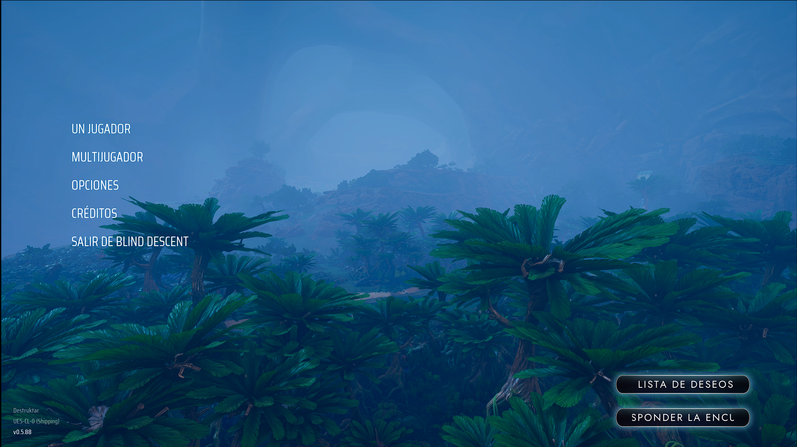
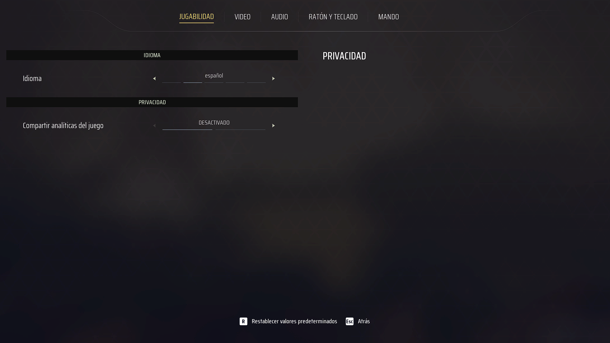
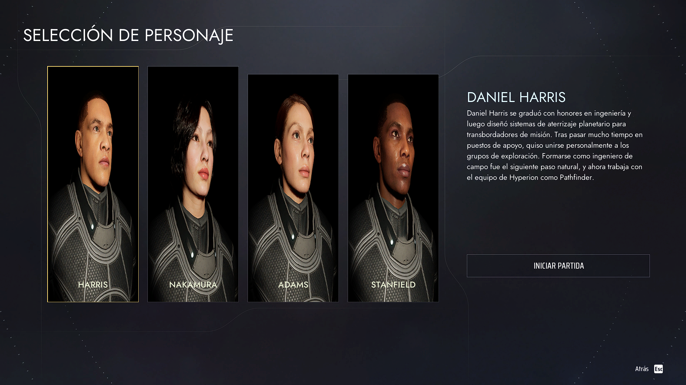
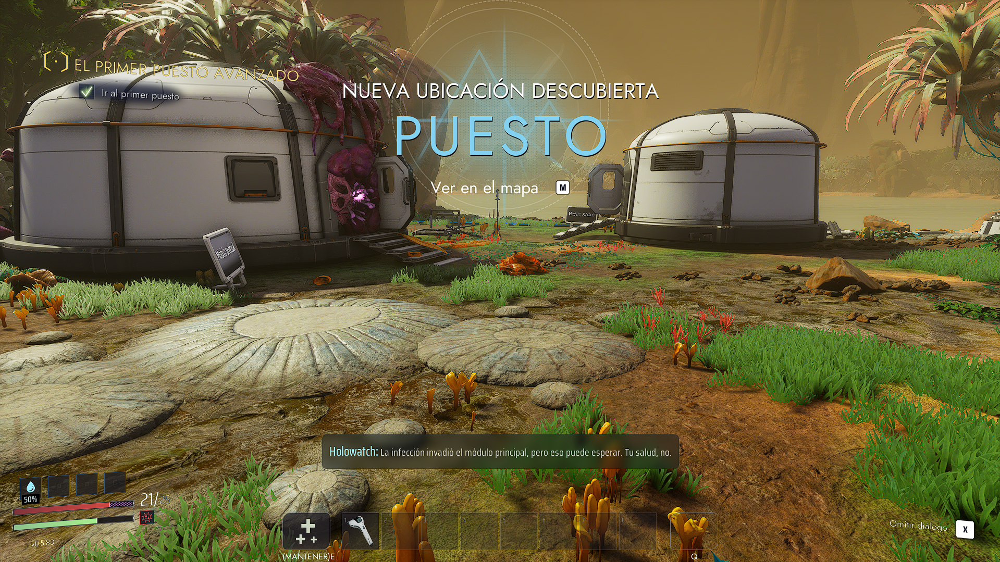

# Traducción al español de Blind Descent (Playtest)

Esta carpeta contiene los archivos de traducción al español para la versión de **Blind Descent Playtest** de Steam.

## Capturas

### Menú



### Configuración



### Selección de jugador



### Juego



## Instalación

1. Cierra el juego si está abierto.
2. En Steam, abre **Biblioteca** y busca **Blind Descent Playtest**.
3. Haz clic derecho en el juego y selecciona **Propiedades**.
4. Entra en **Archivos instalados** y pulsa **Explorar**. Se abrirá la carpeta de instalación del juego.
5. Abre la carpeta **BlindDescent**, luego **Content** y después **Paks**.
6. Copia `pakchunk99-Windows.pak` desde esta descarga y pégalo en esa carpeta **Paks**, junto a los demás paquetes del juego. No reemplaces ningún archivo existente.
7. Vuelve a la carpeta descargada `BlindDescent_ES`. Copia la carpeta **Content** que está junto al archivo `.pak`.
8. Pega esa carpeta **Content** directamente dentro de **BlindDescent**, la misma carpeta que contiene la carpeta **Paks**. Si Windows pregunta si quieres combinar las carpetas, acepta. No pegues `Content` dentro de `Paks`.
9. Comprueba que el archivo quede en esta ubicación:

   ```text
   BlindDescent\Content\Localization\Game\es\Game.locres
   ```

10. Inicia el juego. En **Configuración > Idioma**, selecciona **Español**.

> En una instalación limpia, la ruta `Content\Localization\Game` todavía no existe porque los archivos originales del juego están dentro de sus paquetes. Lo normal es que Windows solo pregunte si quieres combinar la carpeta `Content`; acepta. No debería pedir reemplazar archivos.

## Desinstalación

Cierra el juego y elimina únicamente estos elementos añadidos:

- `BlindDescent\Content\Paks\pakchunk99-Windows.pak`
- `BlindDescent\Content\Localization\Game\es`

No elimines los otros archivos `.pak`, `.utoc` o `.ucas` del juego.

## Archivos de esta descarga

- `pakchunk99-Windows.pak`: paquete adicional de Unreal Engine.
- `Content\Localization\Game\Game.locmeta`: metadatos de localización.
- `Content\Localization\Game\es\Game.locres`: textos en español que carga el juego.
- `SpanishPak.txt`: archivo auxiliar usado para crear el `.pak`; no hace falta instalarlo.


